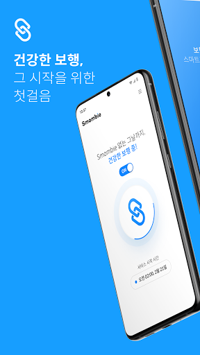
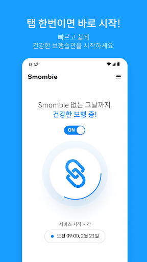
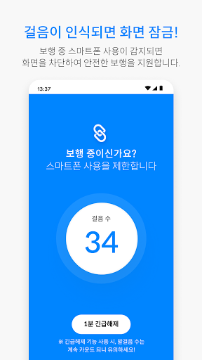
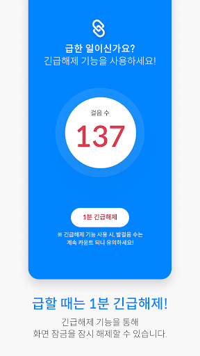
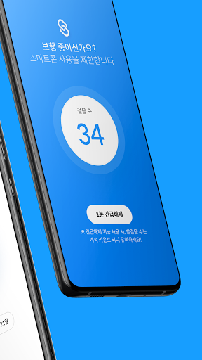
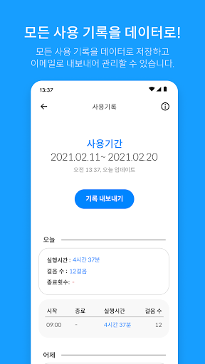

# Smombie

보행 중 스마트폰 사용을 막아 **스몸비(Smombie, Smartphone + Zombie)** 를 예방하는 Android 앱입니다.
걸음이 감지되면 화면을 잠가 사용을 제한하고, 걸음 수와 사용 기록을 남깁니다.

> 건강한 보행, 그 시작을 위한 첫걸음.

<p align="center">
  
  
  
  
</p>

## 주요 기능

- **보행 감지 잠금**: 걷는 동안 화면 위에 잠금 오버레이를 띄워 스마트폰 사용을 제한합니다.
- **걸음 수 카운트**: 잠금 화면이 켜진 상태에서 걸음 수를 측정합니다.
- **1분 긴급해제**: 급한 상황에서는 1분간 잠금을 임시 해제할 수 있습니다. (해제 중에도 걸음 수는 계속 카운트)
- **사용 기록**: 시작/종료 시간, 실행 시간, 걸음 수, 종료 횟수를 최대 2주간 저장하고 2주가 지나면 자동 삭제합니다.
- **기록 내보내기**: 사용 기록을 Excel 파일로 만들어 등록한 이메일로 전송합니다.
- **버그 제보 / 버전 정보 / 개인정보처리방침** 화면 제공.

## 화면

| 온보딩 | 보행 잠금 안내 | 메인 (실행) | 보행 잠금 |
| :---: | :---: | :---: | :---: |
|  |  |  |  |
| **긴급해제** | **사용 기록** | **시작 화면** | |
|  |  |  | |

## 동작 방식

1. `StepService`(포그라운드 서비스)가 `TYPE_STEP_DETECTOR` / `TYPE_STEP_COUNTER` 센서를 구독합니다.
2. 화면이 켜진 상태에서 걸음이 감지되면 `WindowManager`로 잠금 화면(`lock_screen_view`)을 오버레이로 표시합니다.
3. 화면이 꺼지거나 긴급해제 타이머가 끝나면 잠금을 해제합니다.
4. 측정된 걸음 수와 실행 정보는 `SharedPreferences` / SQLite(`DBHelper`)에 저장되어 사용 기록으로 관리됩니다.

## 필요 권한

| 권한 | 용도 |
| --- | --- |
| `SYSTEM_ALERT_WINDOW` | 보행 중 화면 위 잠금 오버레이 표시 |
| `ACTIVITY_RECOGNITION` | 걸음(신체 활동) 감지 |
| `FOREGROUND_SERVICE` | 백그라운드 걸음 측정 서비스 유지 |
| `REQUEST_IGNORE_BATTERY_OPTIMIZATIONS` | 배터리 최적화에 의한 강제 종료 방지 |
| `READ/WRITE_EXTERNAL_STORAGE` | 사용 로그(Excel) 생성·저장 |
| `INTERNET` | 기록 이메일 전송, 버전 확인 |

> 필수 권한을 허용하지 않으면 앱이 정상 동작하지 않습니다.

## 기술 스택

- **언어**: Kotlin
- **최소/타깃 SDK**: minSdk 23 / targetSdk 30 (compileSdk 30)
- **UI**: Android View + ViewBinding
- **저장소**: SQLite(`DBHelper`), SharedPreferences
- **엑셀**: Apache POI (`poi`, `poi-ooxml`)
- **위치/센서**: `play-services-location`, SensorManager (Step Detector/Counter)
- **기타**: Jsoup(버전 확인), Material Components

## 프로젝트 구조

```
app/src/main/java/com/picka/smombieapp/
├── base/          BaseActivity, BaseApplication
├── brodcast/      ScreenReceiver, SmombieReceiver, MidnightCallReceiver 등 브로드캐스트
├── service/       StepService (걸음 감지 · 잠금 오버레이)
├── view/          MainActivity, HistoryActivity, 잠금/다이얼로그 등 화면
│   ├── intro/     SplashActivity, PermissionActivity, PrivacyActivity
│   ├── history/   HistoryActivity, HistoryAdapter
│   └── dialog/    커스텀 다이얼로그
├── data/          HistoryData
└── utils/         DBHelper, ExcelUtil, EmailUtil, DateFormatUtil, Constants 등
```

## 빌드

```bash
./gradlew assembleDebug
```

생성된 APK는 `app/build/outputs/apk/`에서 확인할 수 있습니다.

## 라이선스

별도 라이선스가 명시되어 있지 않습니다. 사용 전 저장소 소유자에게 문의하세요.
